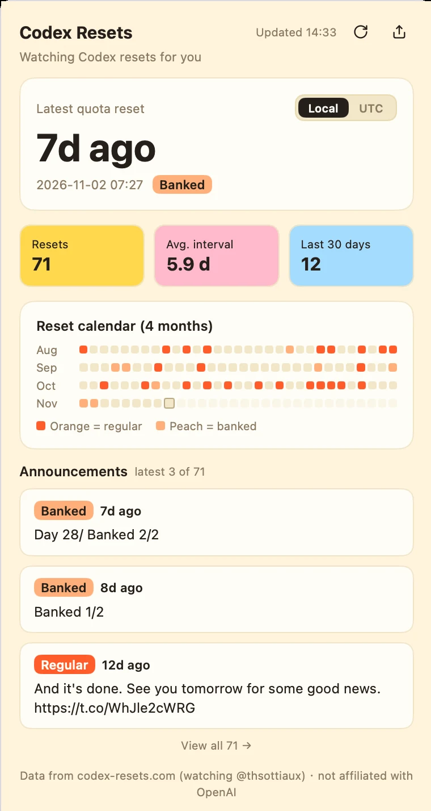

# Codex Resets Bar

Never miss a Codex quota reset again.



A dashboard for [Metrix.Bar](https://metrix.bar) that sits in your menu bar, watches OpenAI Codex reset announcements, and tells you the moment one lands — no tab to keep open, no site to refresh.

[中文说明](README.zh-CN.md)

## Install

Two builds, identical panel behaviour, different interface language and runtime CDN:

| Build | Interface | Vue runtime from | Size |
|---|---|---|---|
| [`codex-resets-en.bar`](https://cdn.jsdelivr.net/gh/0tt0/codex-resets-bar@v0.1.3/codex-resets-en.bar) | English | jsDelivr | 32 KB |
| [`codex-resets.bar`](https://cdn.jsdmirror.com/gh/0tt0/codex-resets-bar@v0.1.3/codex-resets.bar) | 中文 | JSDMirror | 32 KB |

Download the file and open it — Metrix.Bar registers the `.bar` file type, so it goes straight to the import confirmation.

Or paste this into your browser's address bar:

```text
metrixbar://install?url=https%3A%2F%2Fcdn.jsdelivr.net%2Fgh%2F0tt0%2Fcodex-resets-bar%40v0.1.3%2Fcodex-resets-en.bar&sha256=6e3233b23746948311e2a3d03d784745c512cf0f94ecf64e0ad93c9228d387de
```

GitHub strips custom URL schemes from rendered Markdown, so the link is copyable text rather than a clickable anchor. For the Chinese build, swap `jsdelivr.net` for `jsdmirror.com` and `codex-resets-en.bar` for `codex-resets.bar`.

Either way Metrix.Bar validates the HTTPS source, shows the requested permissions, and installs after you confirm. A local install keeps the original dashboard ID, records the download as its provenance, and never joins a registry.

Once installed the panel declares `placements="menubar"` and `open-mode="flyout"`: it lives in the menu bar and opens as a 380×600 flyout. Both builds target `.bar` protocol version 0.

## What you get

- **How long since the last reset** — a large relative time plus the exact timestamp, switchable between local time and UTC.
- **Which kind of reset it was** — regular resets and banked allowances are labelled differently, so you know what dropped.
- **The rhythm, not just the latest one** — a four-month calendar heatmap of resets.
- **Pace at a glance** — resets in the last 30 days, average interval, days since the last one.
- **Alerts that don't lie** — a notification and toast when a new announcement appears; installing never fires a stale one.
- **Share without screenshotting by hand** — one click copies a capture of the panel to your clipboard.

## When the network misbehaves

A failed refresh keeps the last good data on screen and offers Retry, so a flaky connection never leaves you with an empty panel. Requests go directly to `codex-resets.com`, which must be reachable from your machine.

## Configure

One setting, in the dashboard's settings: **new reset alerts**, on by default. Everything else is deliberately fixed — refresh every 2 minutes, the latest three announcements, with a link to the full archive.

## Where the numbers come from

[codex-resets.com](https://codex-resets.com) publishes a public API; this dashboard reads `/status` and `/resets` and links back to the site. It is **not affiliated with codex-resets.com or OpenAI**.

## License

[Apache-2.0](LICENSE). The Vue runtime is loaded at startup from a public CDN (jsDelivr for the English build, JSDMirror for the Chinese build) rather than bundled here, and remains under its MIT license. "OpenAI" and "Codex" are trademarks of OpenAI, used only to identify the service this dashboard monitors.
