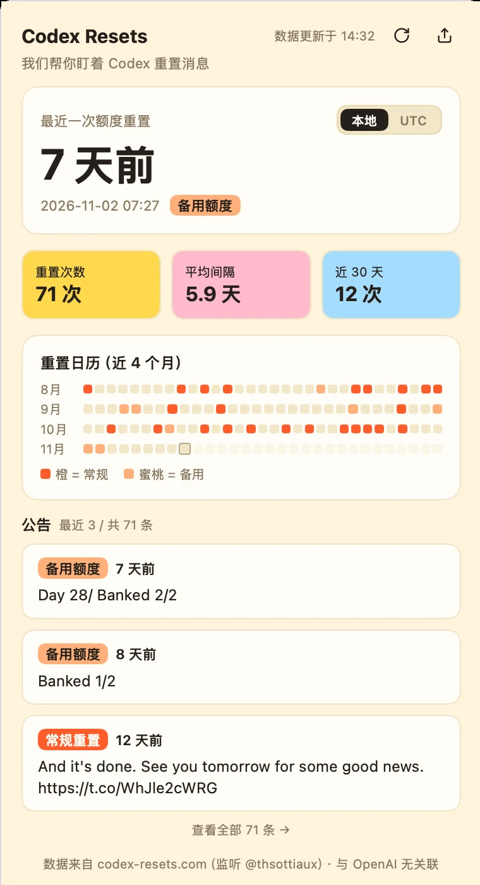

# Codex Resets Bar

Codex 额度什么时候重置，你不用再盯着官网刷新。



一个常驻菜单栏的 [Metrix.Bar](https://metrix.bar) 看板，盯着 OpenAI Codex 的重置公告，一有新动静就告诉你。

[English](README.md)

## 安装

两个构建，面板行为一致，只是界面语言和运行时镜像不同：

| 构建 | 界面 | Vue 运行时来自 | 大小 |
|---|---|---|---|
| [`codex-resets.bar`](https://cdn.jsdmirror.com/gh/0tt0/codex-resets-bar@v0.1.4/codex-resets.bar) | 中文 | JSDMirror（jsDelivr 国内镜像） | 32 KB |
| [`codex-resets-en.bar`](https://cdn.jsdelivr.net/gh/0tt0/codex-resets-bar@v0.1.4/codex-resets-en.bar) | English | jsDelivr | 32 KB |

下载后打开即可：Metrix.Bar 已关联 `.bar` 文件类型，打开就进入导入确认。

或者把直连导入命令粘到浏览器地址栏：

```text
metrixbar://install?url=https%3A%2F%2Fcdn.jsdmirror.com%2Fgh%2F0tt0%2Fcodex-resets-bar%40v0.1.4%2Fcodex-resets.bar&sha256=88d682087b4eb91be78798b564e6abd4e94fb69bbaa1a20d7b1358f5942766dd
```

GitHub 渲染 Markdown 时会剥离自定义协议，所以这里以可复制文本给出。想装英文版，把域名换成 `cdn.jsdelivr.net`、文件名换成 `codex-resets-en.bar`。

两种方式都由 Metrix.Bar 校验 HTTPS 来源、展示看板申请的权限，确认后才安装。本地安装保留原始看板 ID，把下载地址记为来源，不会挂到任何注册表。

装好后看板声明了 `placements="menubar"` 与 `open-mode="flyout"`：常驻菜单栏，点击展开 380×600 下拉面板。两个构建都遵循 `.bar` 协议版本 0。

## 它能帮你做什么

- **一眼知道上次重置过去多久** —— 大号相对时间配精确时间戳，可切换本地时间与 UTC。
- **分清是哪一种重置** —— 常规重置和备用额度用不同标签标出，不用再猜。
- **看到节奏，而不只是最新一次** —— 近四个月的日历热力图，一眼看出重置频率。
- **顺手了解当前进度** —— 近 30 天次数、平均间隔、距上次天数。
- **提醒不会误报** —— 新公告出现才发通知和 toast；刚装完不会蹦出一条过期的。
- **分享不用自己截图** —— 点一下就把面板截图复制到剪贴板。

## 网络出问题时

刷新失败会保留上一次成功的数据，并给出重试入口，不会因为一次网络抖动就变成空面板。请求直连 `codex-resets.com`，本机需要能访问该域名。

## 配置

只有一个开关，在面板设置里：**新重置提醒**，默认开启。其余都是刻意的固定选择——每 2 分钟刷新、只展示最近 3 条公告，并给出完整归档的入口。

## 数据从哪来

[codex-resets.com](https://codex-resets.com) 提供公开 API，本看板读取其中的 `/status` 与 `/resets`，并回链到该站。本项目与 **codex-resets.com、OpenAI 均无隶属关系**。

## 许可

[Apache-2.0](LICENSE)。Vue 运行时在启动时从公共 CDN 加载（英文构建走 jsDelivr，中文构建走 JSDMirror 镜像），不随本仓库分发，仍适用其 MIT 协议。「OpenAI」「Codex」为 OpenAI 商标，此处仅用于标识本看板所监控的服务。
