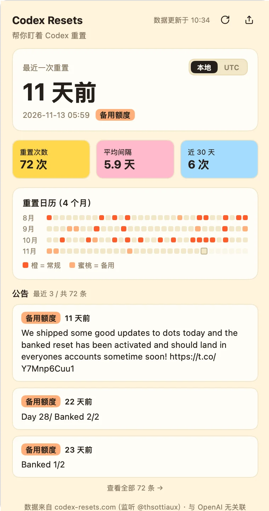

# Codex Resets Bar

Codex 额度什么时候重置，你不用再盯着官网刷新。

一个常驻菜单栏的 [Metrix.Bar](https://metrix.bar) 看板，盯着 OpenAI Codex 的重置公告，一有动静就告诉你。[English](README.md)

## 安装

点开下面的链接，再打开下载好的文件即可 —— Metrix.Bar 直接导入 `.bar`。

- [`codex-resets.bar`](https://cdn.jsdelivr.net/gh/0tt0/codex-resets-bar@v0.2.0/codex-resets.bar)

也可以把下面这行粘到浏览器地址栏，直接从 CDN 导入：

```text
metrixbar://install?url=https%3A%2F%2Fcdn.jsdelivr.net%2Fgh%2F0tt0%2Fcodex-resets-bar%40v0.2.0%2Fcodex-resets.bar&sha256=fc7fbea1177732718bb8141b652681f5a00b11f5c3b80e913e24a6921476916c
```

GitHub 渲染 Markdown 时会剥离自定义协议，所以这里以可复制文本给出。

看板语言跟随 Metrix.Bar 宿主显示语言——`zh*` 显示中文，其余显示英文。语言在 Worker 创建（安装或重载看板）时捕获，切换系统或宿主语言后需重载看板才生效。

## 它能帮你做什么

- **一眼知道上次重置过去多久**，可切本地时间或 UTC。
- **分清常规重置与备用额度**，标签不同。
- **近四个月日历**，看到节奏而不只是最新一次。
- **顺手掌握进度**：近 30 天次数、平均间隔、距上次天数。
- **新公告才发通知**，刚装完不会蹦出过期的。
- **点一下把面板截图复制到剪贴板**。



## 补充说明

每 2 分钟刷新一次；请求失败会保留上一次的数据并给出重试，不会变成空面板。请求直连 `codex-resets.com`，本机需要能访问该域名。提醒默认开启，可在看板设置里关闭。Vue 运行时在启动时从 CDN 加载：主源 JSDMirror，jsDelivr 兜底。

## 来源与许可

数据来自 [codex-resets.com](https://codex-resets.com) 的公开 API，与本项目无隶属关系，也不代表 OpenAI。

[Apache-2.0](LICENSE)。Vue 运行时在启动时从 CDN 加载（主源 JSDMirror、jsDelivr 兜底），仍适用其 MIT 协议。「OpenAI」「Codex」为 OpenAI 商标，仅用于标识所监控的服务。
